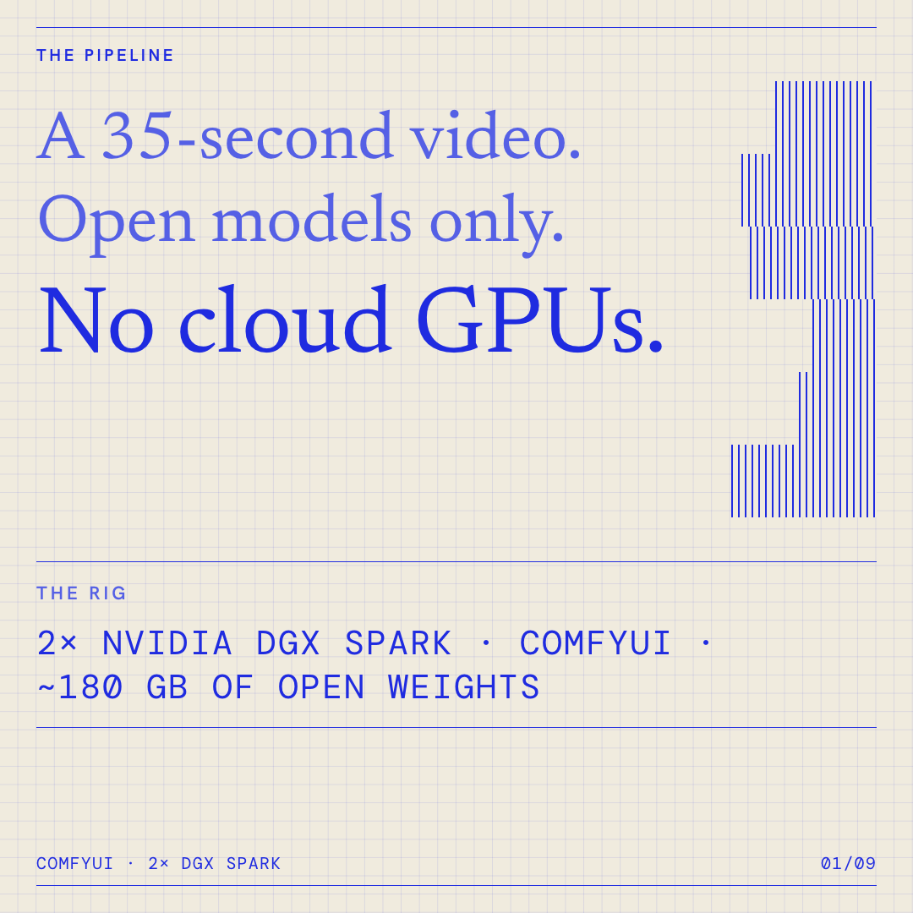
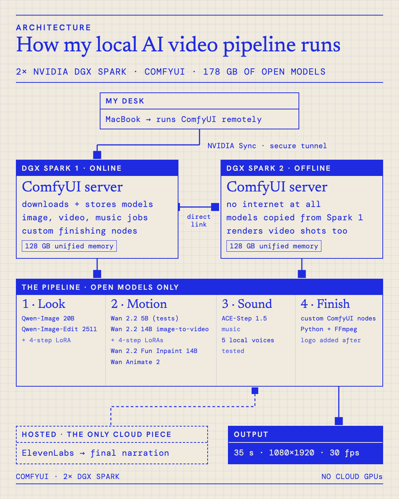
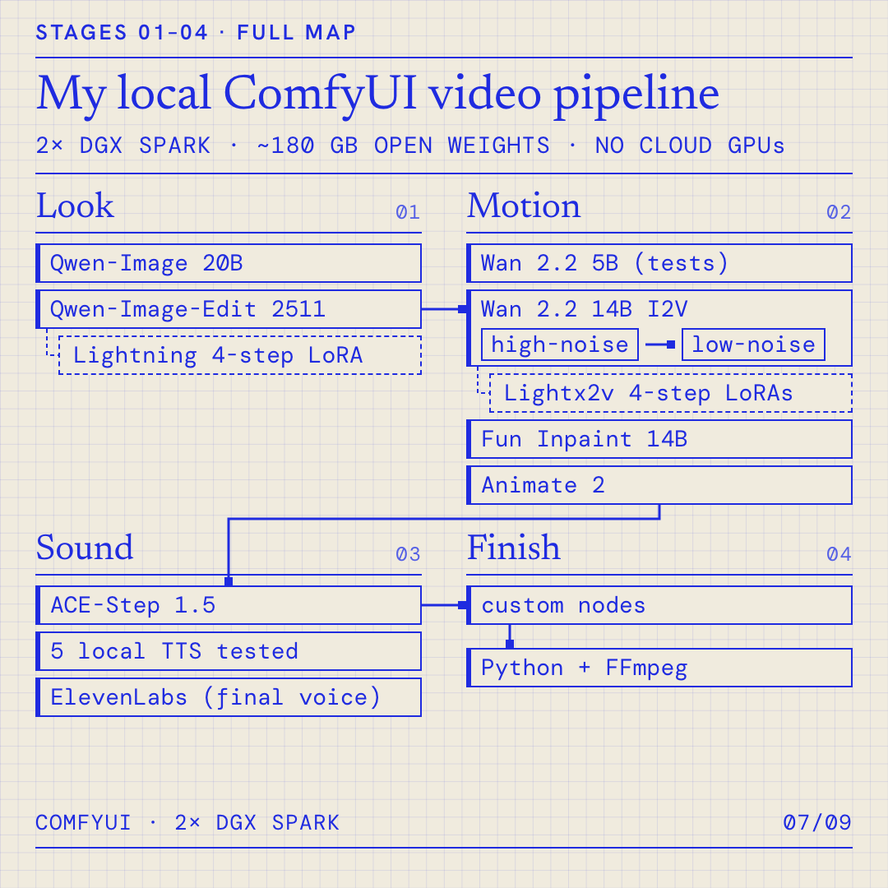

# 01 · ComfyUI video pipeline

I made a 35-second vertical video with open models only, running locally in ComfyUI on two DGX Sparks.
This folder explains the setup, the models in each step and what I learned.

▶ [Watch the 53-second explainer](media/pipeline-explainer.mp4) (MP4, square, quiet background music made locally with ACE-Step 1.5)

## How it runs

- **My desk:** a MacBook drives ComfyUI remotely through NVIDIA Sync's secure tunnel.
- **Spark 1 (online):** runs ComfyUI, downloads and stores the models (178 GB), and runs image, video and music jobs plus the custom finishing nodes.
- **Spark 2 (offline):** also runs ComfyUI, has no internet at all, gets its models copied over a direct link from Spark 1, and renders video shots too.
- **The only cloud piece:** the final narration voice (ElevenLabs).

## The models, step by step

| Step | Model | What it does |
|---|---|---|
| 1 · Look | Qwen-Image 20B (fp8) | Text-to-image for the characters and scenes; text encoder Qwen2.5-VL 7B |
| | Qwen-Image-Edit 2511 + Lightning 4-step LoRA | Revises a design without starting over |
| 2 · Motion | Wan 2.2 TI2V 5B | Fast motion tests before committing to big renders |
| | Wan 2.2 I2V 14B (fp8) + Lightx2v 4-step LoRAs | Production shots; two experts run in turn: high-noise (composition and motion), then low-noise (detail) |
| | Wan 2.2 Fun Inpaint 14B | Pins a clip's first and last frame so shots join up |
| | Wan Animate 2 | Copies motion from a reference clip onto a character |
| | umT5-XXL, Wan 2.1 / 2.2 VAEs, CLIP Vision H | Shared encoders and decoders |
| 3 · Sound | ACE-Step 1.5 turbo | Music |
| | Kokoro, Piper, VoxCPM2, Chatterbox, Qwen3-TTS | Five local voices compared; none sounded natural enough |
| | ElevenLabs (hosted) | Final narration |
| 4 · Finish | Custom ComfyUI nodes → Python + FFmpeg | Cut, mix to −14 LUFS, export 1080×1920 at 30 fps; real logo and text added after generation |

I only used models whose licences allow commercial use.

## What I learned

1. **Wan 2.2 14B is really two models.** A high-noise expert lays out composition and motion, then a low-noise expert adds detail. You run both, one after the other.
2. **4-step distillation LoRAs make local iteration practical.** 4 sampling steps instead of 20+.
3. **A fixed seed doesn't keep a character consistent.** Reference images, keyframes and checking contact sheets frame by frame do.
4. **Never trust text generated inside an image.** Composite logos and words from the real assets afterwards.
5. **Write acceptance criteria before you render.** "Character stays on-model", "objects don't melt" and "continuity holds across cuts" turn vague feedback into checks.
6. **Version every workflow.** Some shots went through six versions; each workflow is saved as JSON next to its output.

**Biggest surprise:** the open video models were closer to production-ready than the open voice models.

## Files

| File | What it is |
|---|---|
| `media/pipeline-explainer.mp4` | 53.5 s explainer, 1080×1080, H.264 + AAC |
| `media/architecture.png` | How the machines connect (1080×1350) |
| `media/full-map.png` | Every model in each step (1080×1080) |
| `media/cover-hook.png` | Cover image for the explainer |

The explainer was built with [HyperFrames](https://github.com/heygen-com/hyperframes) (HTML-to-video). Its soundtrack was generated locally with ACE-Step 1.5. Fonts: Newsreader, Hanken Grotesk and DM Mono (SIL Open Font License).
